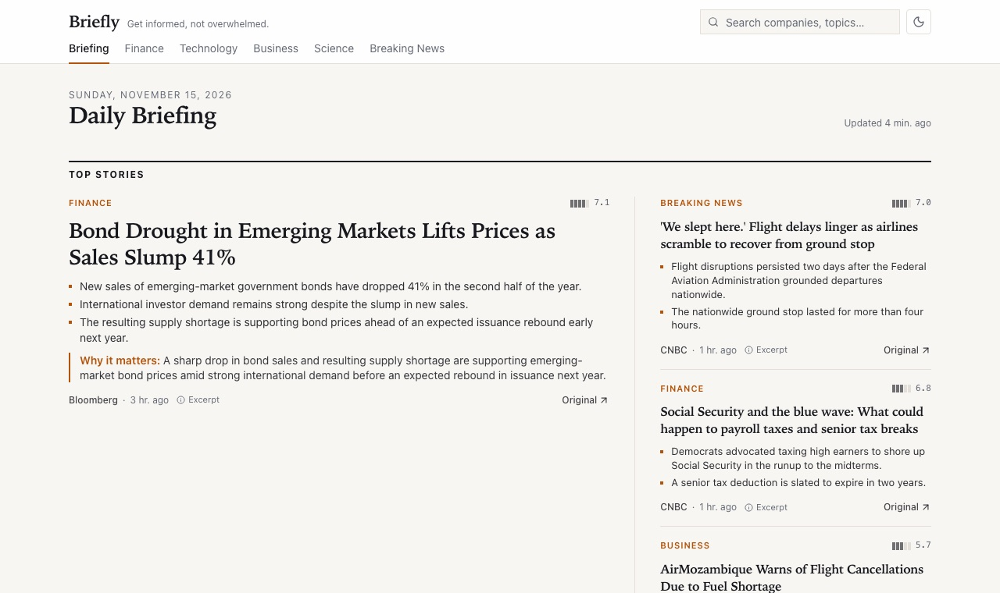
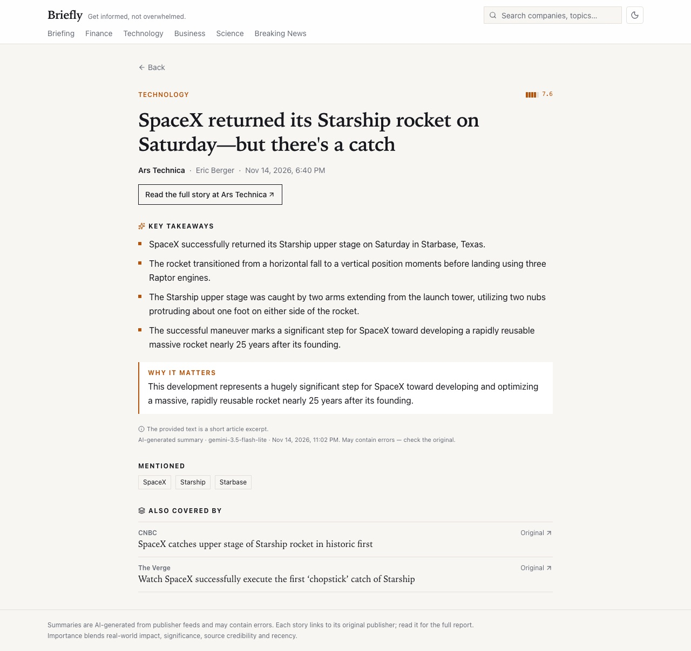
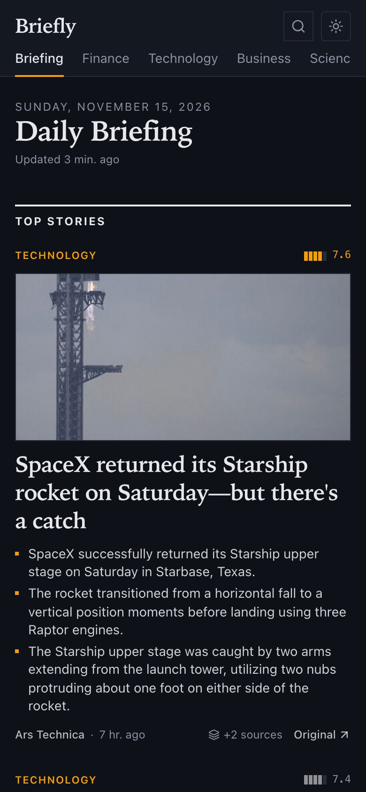

# Briefly

**Get informed, not overwhelmed.** Briefly collects news from reputable publishers across
finance, technology, business and science. It removes duplicates, categorizes and ranks
stories by importance, and writes short AI summaries, so you can read the day's briefing in
minutes. Every story links back to the original article.



<table><tr>
<td width="62%"></td>
<td></td>
</tr></table>

## What it does

- **Ingests** official feeds from CNBC, Bloomberg, TechCrunch, The Verge, Ars Technica and MIT
  Technology Review every 15 minutes. It uses conditional requests and retries, and one
  publisher failing never affects the others.
- **Deduplicates** on five levels (URL, normalized URL, feed ID, content hash, headline
  similarity). Different outlets covering the same event are **grouped**, not discarded.
- **Summarizes** with Google Gemini: 3–5 checked takeaways, why it matters, and key entities.
  Summaries are honest about their source: excerpt-only feeds are labelled, and headline-only
  items are never summarized.
- **Ranks** by impact, significance, source credibility and recency, with configurable weights.
  It never uses popularity.
- **Serves** a REST API and a fast editorial web app: briefing, category feeds, article pages
  and full-text search, in light and dark themes, on desktop and mobile.

## Stack

| Layer    | Technology |
| -------- | ---------- |
| Frontend | React 19, TypeScript, Vite, Tailwind CSS v4, React Router, Lucide |
| Backend  | Python, Flask, SQLAlchemy 2, Alembic (Flask-Migrate), Pydantic, httpx, feedparser |
| Database | PostgreSQL: UUID keys, JSONB, GIN full-text indexes |
| AI       | Google Gemini (Interactions REST API), schema-validated JSON output |
| Infra    | Docker, Docker Compose (dev and prod), nginx, GitHub Actions |

## Quick start (Docker)

```bash
cp .env.example .env     # then set GEMINI_API_KEY (free key: https://aistudio.google.com/apikey)
docker compose up --build
```

- App: http://localhost:5173
- API: http://localhost:8000/api/briefing/today
- API docs: [docs/api.md](docs/api.md), or OpenAPI at http://localhost:8000/api/openapi.json

The backend applies migrations on start. The `worker` ingests and summarizes immediately, then
every 15 minutes. Without a Gemini key everything still works except summaries: articles show
the publisher's description until a key is set.

**Production-style stack** (nginx serving the built app and proxying the API):

```bash
docker compose -f docker-compose.prod.yml up --build -d    # needs POSTGRES_USER/PASSWORD in .env
```

## Quick start (without Docker)

Requires Python 3.12+, Node 24+ and PostgreSQL.

```bash
createdb briefly && createdb briefly_test

cd backend
python3 -m venv .venv && source .venv/bin/activate
pip install -r requirements-dev.txt
flask --app app.wsgi db upgrade
flask --app app.wsgi ingest run            # fetch news once
flask --app app.wsgi process run           # categorize, rank, summarize
flask --app app.wsgi run --port 8000       # API (or: gunicorn app.wsgi:app)
# flask --app app.wsgi ingest worker       # optional: keep ingesting every 15 minutes

cd ../frontend && npm install && npm run dev   # http://localhost:5173
```

Settings are read from the repo-root `.env`. See [docs/development.md](docs/development.md) for
every variable and the operational commands (`sources list`, `ai usage`, `summaries regenerate`).

## Tests and checks

```bash
cd backend  && pytest --cov && ruff check . && mypy            # needs TEST_DATABASE_URL
cd frontend && npm run test:coverage && npm run lint && npm run typecheck && npm run build
```

Backend: 234 tests at 95.6% coverage, against real PostgreSQL. Frontend: 52 tests at 95%
coverage. CI also builds the Docker images and smoke-tests both the dev and production stacks.

## Documentation

- [Architecture](docs/architecture.md): pipeline, data model, deduplication, AI policy,
  frontend, sources and licensing, design decisions
- [API](docs/api.md): endpoints, parameters, status codes, objects
- [Development](docs/development.md): environment variables, commands, conventions
- [Acceptance audit](docs/acceptance.md): each MVP criterion with its evidence, plus the security checklist
- [Roadmap](docs/roadmap.md): completed milestones, known limitations, future work

## Data and content

Briefly reads only publisher-provided feeds and never fetches article pages or bypasses
paywalls. Summaries are AI-generated and may contain errors; each one links to the original.
Review each publisher's feed terms before any public or commercial deployment.
